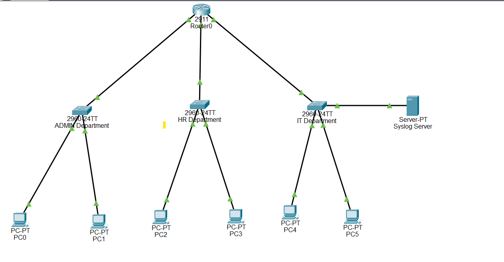
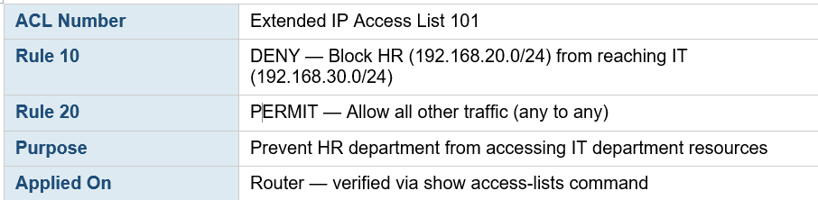

# Cisco Packet Tracer – Secure Office Network

## Project Overview
This project demonstrates the design and implementation of a secure office network using Cisco Packet Tracer. It includes VLAN segmentation, inter-VLAN routing using Router-on-a-Stick, and Access Control Lists (ACLs) to enforce communication restrictions between departments.

## Technologies Used
- Cisco Packet Tracer
- VLAN
- Inter-VLAN Routing
- Router-on-a-Stick
- Access Control Lists (ACL)
- IPv4 Addressing

## Objectives
- Design a secure office network.
- Configure VLANs for network segmentation.
- Enable Inter-VLAN communication using Router-on-a-Stick.
- Implement an Access Control List (ACL) to restrict unauthorized communication.
- Verify connectivity and security using Cisco CLI commands.

## Network Configuration
| Department | VLAN | Subnet | Gateway |
|------------|------|----------------|----------------|
| ADMIN | VLAN 10 | 192.168.10.0/24 | 192.168.10.1 |
| HR | VLAN 20 | 192.168.20.0/24 | 192.168.20.1 |
| IT | VLAN 30 | 192.168.30.0/24 | 192.168.30.1 |

## Security Features
- VLAN segmentation for ADMIN, HR, and IT departments.
- Inter-VLAN routing using Router-on-a-Stick.
- Extended ACL 101 configured to block HR from accessing the IT network.
- Verified configuration using Cisco CLI commands.

## Skills Demonstrated
- Network Design
- VLAN Configuration
- Router Configuration
- Inter-VLAN Routing
- Access Control Lists (ACL)
- IPv4 Addressing
- Network Troubleshooting
- Cisco CLI

## Files Included
- `Secure_Office_Network.pkt` – Cisco Packet Tracer project file.
- `Secure office network.pdf` – Project documentation.

## Project Screenshots

### Network Topology

### Router — Sub-interfaces & Routing Table

### Switch 1 — VLAN 10 (ADMIN)
.png)

### Switch 2 — VLAN 20 (HR)
.png)

### Switch 3 — VLAN 30 (IT)
.png)

### ACL 101

